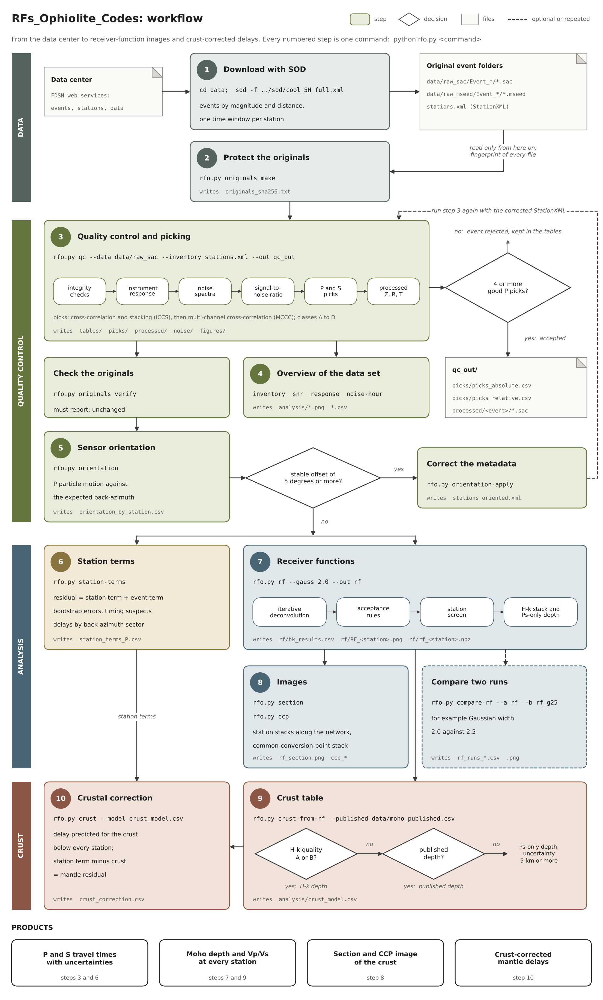
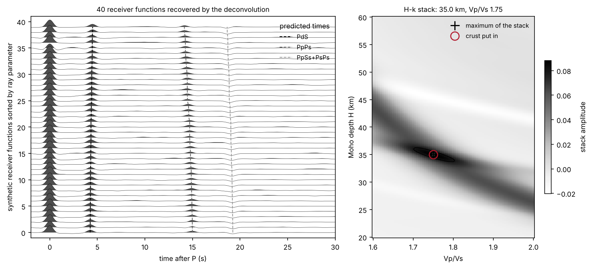

# RFs_Ophiolite_Codes

Teleseismic receiver functions across an ophiolite: download, quality control,
travel-time picks, receiver functions, H-k stacking, common-conversion-point imaging
and crustal correction, as one command-line package with numbered steps.

The codes were developed on the COOL network (FDSN code 5H, 2013 to 2016), 49 broadband
stations across the Semail ophiolite and the Oman Mountains of northern Oman. They work
on any set of event folders written by SOD, and the settings that belong to COOL are
collected in one place (see [docs/ADAPTING.md](docs/ADAPTING.md)).

The package is also meant for training: every step is one command, the steps are
numbered in the order they are run, and each one writes its tables and figures to a
folder that the next step reads.

## Workflow



A text version of the chart and a description of every step are in
[docs/WORKFLOW.md](docs/WORKFLOW.md).

## Quick start

```
git clone https://github.com/MohammadYoussof/RFs_Ophiolite_Codes.git
cd RFs_Ophiolite_Codes
conda env create -f environment.yml        # or: pip install -r requirements.txt
conda activate rfs_ophiolite

python rfo.py --help                       # the commands in the order of the workflow
python rfo.py demo --out demo_output       # synthetic test, no data needed
python rfo.py rf --help                    # the options of one command
```

The synthetic test builds seismograms for a crust of known thickness and Vp/Vs, runs
the deconvolution and the H-k stack on them, and reports `PASSED` when the crust is
recovered. It is the fastest way to see that the installation works and what a receiver
function and an H-k stack look like.



## The steps

| Step | What it does | Command | Main results |
|---|---|---|---|
| 1 | Download event data with SOD | `sod -f ../sod/cool_5H_full.xml` (in `data/`) | `data/raw_sac/`, `data/raw_mseed/` |
| 2 | Protect the originals | `rfo.py originals make` | `originals_sha256.txt` |
| 3 | Quality control and picking | `rfo.py qc` | `qc_out/tables`, `picks`, `processed`, `noise`, `figures` |
| 4 | Overview of the data set | `rfo.py inventory`, `snr`, `response`, `noise-hour` | coverage, availability, integrity, visibility |
| 5 | Sensor orientation | `rfo.py orientation`, `orientation-apply` | offsets per station, corrected StationXML |
| 6 | Station terms | `rfo.py station-terms` | station and event terms, direction dependence |
| 7 | Receiver functions | `rfo.py rf` | receiver functions, H-k results, station figures |
| 8 | Images | `rfo.py section`, `rfo.py ccp` | station section, CCP volume, profiles, depth slices |
| 9 | Crust table | `rfo.py crust-from-rf` | Moho depth of every station with its source |
| 10 | Crustal correction | `rfo.py crust` | crustal delay and mantle residual per station |

Optional: `rfo.py handpick` and `compare-picks` (blind manual picks against the
automatic ones), `rfo.py compare-rf` (two receiver-function runs, for example two
Gaussian widths), `rfo.py mseed-metadata` (event catalog and station table for the
miniSEED copy of the data).

The whole sequence with all options is in [run_workflow.sh](run_workflow.sh). A minimal
run looks like this:

```
python rfo.py originals make data/raw_sac data/raw_mseed -m originals_sha256.txt
python rfo.py qc --data data/raw_sac --inventory stations.xml --out qc_out --workers 6
python rfo.py originals verify -m originals_sha256.txt

python rfo.py inventory     --qc qc_out
python rfo.py station-terms --qc qc_out
python rfo.py rf            --qc qc_out --gauss 2.0
python rfo.py section       --qc qc_out
python rfo.py ccp           --qc qc_out
python rfo.py crust-from-rf --qc qc_out --published data/moho_published.csv
python rfo.py crust         --qc qc_out --model qc_out/analysis/crust_model.csv
```

## What is in the repository

```
RFs_Ophiolite_Codes/
    rfo.py                  command line: python rfo.py <command>
    run_workflow.sh         all steps in order, as a template
    rf_ophiolite/           the code
        cli.py                  commands and their options
        originals.py            step 2   fingerprints of the original files
        qc_pipeline.py          step 3   quality control and picking
        overview.py             step 4   inventory, snr, response, noise-hour
        orientation.py          step 5   sensor orientation
        manual_picks.py                  handpick, compare-picks
        station_terms.py        step 6   station and event terms
        receiver_functions.py   step 7   deconvolution, H-k stacking
        imaging.py              step 8   section, ccp
        compare.py                       compare-rf
        crust.py                steps 9 and 10
        mseed_metadata.py                metadata for the miniSEED copy
        synthetic.py                     the synthetic test
        common.py                        shared helpers and settings
    sod/                    step 1: SOD recipes and a download check
    data/                   published Moho depths used for comparison
    docs/                   workflow chart, step-by-step guide, methods, output files
    tests/                  small tests of the numerical core
    requirements.txt, environment.yml, LICENSE, CITATION.cff
```

## Data

The COOL data are open at GEOFON (network 5H, https://doi.org/10.7914/SN/5H_2013).
`sod/` holds the two recipes that download them and explains how to get the StationXML
file. No waveform data are stored in this repository.

The original event folders are the data base of a project and must never change. Step 2
sets them aside: every file is fingerprinted with SHA-256 before the first run, every
command only reads them, output folders inside the data folders are refused, and
`rfo.py originals verify` proves after a run that every file is byte-for-byte the same.

## Documentation

| File | Content |
|---|---|
| [docs/WORKFLOW.md](docs/WORKFLOW.md) | every step: command, input, output, what to check |
| [docs/METHODS_QC.md](docs/METHODS_QC.md) | quality control and picking: methods, thresholds, pick files |
| [docs/METHODS_ANALYSIS.md](docs/METHODS_ANALYSIS.md) | station terms, receiver functions, imaging, crustal correction |
| [docs/OUTPUT_FILES.md](docs/OUTPUT_FILES.md) | every table and figure that the commands write |
| [docs/ADAPTING.md](docs/ADAPTING.md) | what to change for another network |
| [sod/README.md](sod/README.md) | the download with SOD |

## Requirements

Python 3.9 or later with NumPy, SciPy, pandas, matplotlib and ObsPy (1.3 or later).
Optional: netCDF4 (for a 3-D shear-velocity model in the crustal correction) and
global-land-mask (for coastlines on the CCP depth slices). SOD is needed for the
download only. The codes were tested with Python 3.13, NumPy 2.5, SciPy 1.18, pandas
3.0, matplotlib 3.11 and ObsPy 1.5.

## Tests

```
python tests/test_core.py        # deconvolution, H-k stack, station terms, migration, checksums
python rfo.py demo               # the synthetic test with its figure
```

Both run in a few seconds and need no data.

## References

- Kennett, B. L. N., Engdahl, E. R. and Buland, R. (1995). Constraints on seismic velocities in the Earth from traveltimes. Geophysical Journal International 122, 108-124.
- Ligorria, J. P. and Ammon, C. J. (1999). Iterative deconvolution and receiver-function estimation. Bulletin of the Seismological Society of America 89, 1395-1400.
- Lou, X., van der Lee, S. and Lloyd, S. (2013). AIMBAT: a Python/Matplotlib tool for measuring teleseismic arrival times. Seismological Research Letters 84, 85-93.
- McNamara, D. E. and Buland, R. P. (2004). Ambient noise levels in the continental United States. Bulletin of the Seismological Society of America 94, 1517-1527.
- Owens, T. J., Crotwell, H. P., Groves, C. and Oliver-Paul, P. (2004). SOD: Standing Order for Data. Seismological Research Letters 75, 515-520.
- VanDecar, J. C. and Crosson, R. S. (1990). Determination of teleseismic relative phase arrival times using multi-channel cross-correlation and least squares. Bulletin of the Seismological Society of America 80, 150-169.
- Weidle, C., Agard, P., Meier, T., Ducassou, C. and El-Hussain, I. (2013). COOL seismic network. GEOFON Data Archive. https://doi.org/10.7914/SN/5H_2013
- Youssof, M., Thybo, H., Artemieva, I. M. and Levander, A. (2013). Moho depth and crustal composition in Southern Africa. Tectonophysics 609, 267-287.
- Zhu, L. and Kanamori, H. (2000). Moho depth variation in southern California from teleseismic receiver functions. Journal of Geophysical Research 105, 2969-2980.

The full list is in the two methods documents.

## Author and license

Mohammad Youssof (https://github.com/MohammadYoussof). Released under the MIT License,
see [LICENSE](LICENSE). If you use the codes, please cite this repository
(see [CITATION.cff](CITATION.cff)) and the data set you apply them to.
