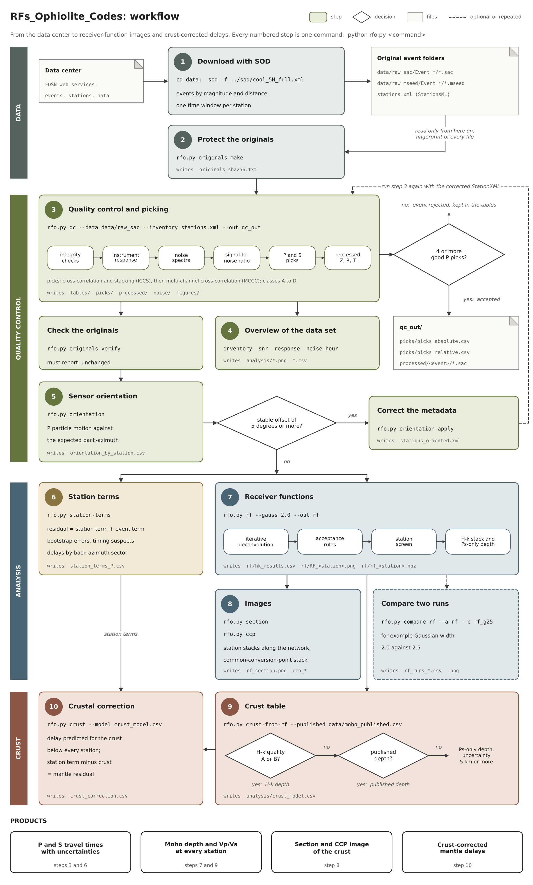
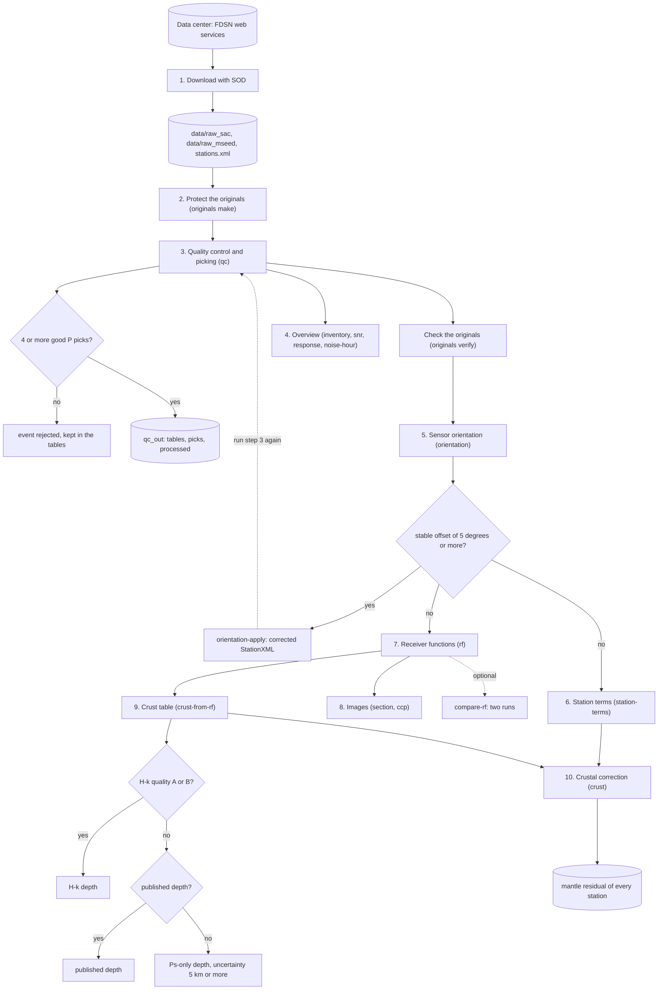

# The workflow, step by step

Every step is one command, `python rfo.py <command>`. The commands are run from the
folder of the repository; the paths below assume this layout:

```
data/raw_sac/Event_*/        original SAC files (read only)
data/raw_mseed/Event_*/      original miniSEED files (read only)
stations.xml                 StationXML at response level
qc_out/                      everything the package writes
```

`python rfo.py --help` lists the commands in this order, and
`python rfo.py <command> --help` lists the options of one command.



The same chart as text (GitHub draws it):



---

## Step 1. Download with SOD

```
mkdir -p data_test && cd data_test
sod -f ../sod/cool_5H_test.xml            # one event, two stations: try this first
python ../sod/verify_download.py          # compares the files with the data center
cd ..

mkdir -p data && cd data
sod -f ../sod/cool_5H_full.xml            # the full data set
cd ..
```

SOD writes into the folder it is started in. Result: `data/raw_sac/` and
`data/raw_mseed/`, one folder per event. Details and the request for the StationXML
file are in [../sod/README.md](../sod/README.md).

Check: the number of event folders, and that `verify_download.py` ends with
"all files match the data center".

## Step 2. Protect the originals

```
chmod -R a-w data/raw_sac data/raw_mseed
python rfo.py originals make data/raw_sac data/raw_mseed -m originals_sha256.txt
```

Result: `originals_sha256.txt`, one SHA-256 checksum per file. From here on the data
folders are only read. After any later step:

```
python rfo.py originals verify -m originals_sha256.txt
```

Check: the last line must read "RESULT: the original data are unchanged".

## Step 3. Quality control and picking

```
python rfo.py qc --data data/raw_sac --inventory stations.xml --out qc_out --workers 6
```

For every event: integrity checks, instrument correction, noise spectra,
signal-to-noise ratios, event screening, P and S picks with a class (A to D) and an
uncertainty, processed Z, R and T traces, and one figure. An interrupted run continues
where it stopped. To follow a single event first:

```
python rfo.py qc --data data/raw_sac --inventory stations.xml --out qc_test --events "Event_2013_11_19*"
```

Result: `qc_out/tables`, `picks`, `processed`, `noise`, `figures`
(see [OUTPUT_FILES.md](OUTPUT_FILES.md)).

Check: the per-event figures in `qc_out/figures`, the list of rejected events with
their reasons in `tables/event_summary.csv`, and `picks_summary.png`.

## Step 4. Overview of the data set

```
python rfo.py inventory  --qc qc_out --listed 1050      # events listed by the download, if known
python rfo.py snr        --qc qc_out
python rfo.py response   --qc qc_out --inventory stations.xml
python rfo.py noise-hour --qc qc_out --utc-offset 4
```

Result: figures and tables in `qc_out/analysis`: event coverage, event selection,
station availability, integrity problems per station, phase visibility, sensor
responses, noise against the time of day.

Check: stations with dead or flat channels, stations that recorded few events, the
back-azimuth coverage (it limits the direction analysis of step 6).

## Step 5. Sensor orientation

```
python rfo.py orientation       --qc qc_out --data data/raw_sac --inventory stations.xml
python rfo.py orientation-apply --qc qc_out --inventory stations.xml --out-xml stations_oriented.xml
```

`orientation` measures, for every good P arrival, the direction of the horizontal
particle motion against the expected back-azimuth. `orientation-apply` sorts the
stations into nominal, correct, uncertain, direction-dependent and insufficient, and
writes a StationXML in which the sensors to correct have their measured azimuth.

If sensors were corrected, run step 3 again with the corrected file into a new folder
and use that folder from here on:

```
python rfo.py qc --data data/raw_sac --inventory stations_oriented.xml --out qc_out2 --workers 6
```

Only the horizontal components change, so the P picks hardly move; the S picks and the
receiver functions do.

Check: `orientation.png`, and in `orientation_corrections.csv` the stations that are
direction-dependent (the offset belongs to the structure, not to the sensor).

## Step 6. Station terms

```
python rfo.py station-terms --qc qc_out2
python rfo.py station-terms --qc qc_out2 --min-quality B --subdir robust_B     # robustness
```

Every residual is split into a station term and an event term by least squares.
Stations whose residuals scatter by more than 0.5 s are flagged as timing suspects (a
clock fault) and left out; the command names them. `--exclude STA1,STA2` leaves out
stations judged unusable in the quality control.

Result: `station_terms_P.csv`, `station_terms_S.csv`, the terms by back-azimuth sector,
maps, and the timing check.

Check: `timing_check_P.png` (a clock fault shows as offsets that change with time), the
bootstrap errors, and how much the terms change between sectors.

## Step 7. Receiver functions

```
python rfo.py rf --qc qc_out2 --gauss 2.0 --workers 6
python rfo.py rf --qc qc_out2 --gauss 2.5 --out rf_g25           # another width, in its own folder
```

Add `--exclude STA1,STA2` for the timing suspects of step 6 and for stations judged
unusable in the quality control.

Every accepted P arrival is deconvolved (radial by vertical). A function is kept if it
passes the acceptance rules and the station screen. Stations with 20 or more functions
are stacked in H-k with bootstrap errors, and the Ps time is also converted to depth
with a fixed Vp/Vs.

Result: `qc_out2/rf/hk_results.csv`, one figure `RF_<station>.png` and one file
`rf_<station>.npz` per station, `rf_summary.csv` with every function.

Check: every station figure. Where the H-k maximum sits at the edge of the Vp/Vs range
(`kappa_at_edge`, quality C) the multiples are too weak and the Ps-only depth is the
value to use. Where two conversions exist, `ps_candidates.csv` lists both.

## Step 8. Images

```
python rfo.py section --qc qc_out2
python rfo.py ccp     --qc qc_out2 --profile 24.45 56.15 21.75 59.85 --profile 23.05 55.70 23.05 60.05
```

`section` draws one moveout-corrected stack per station, sorted by longitude. `ccp`
migrates all functions to depth and stacks them at their conversion points; it writes
the volume, the profiles and depth slices. Both mark the Moho of the crust table if
step 9 has been run before them.

Optional comparison of two runs:

```
python rfo.py compare-rf --qc qc_out2 --a rf --b rf_g25 --label-a "width 2.0" --label-b "width 2.5"
```

Check: that the Moho conversion on the profiles agrees with the station values of
step 7, and how much the Ps time and the H-k depth differ between the two runs.

## Step 9. Crust table

```
python rfo.py crust-from-rf --qc qc_out2 --published data/moho_published.csv
```

One line per station with the Moho depth, its uncertainty and where it comes from: the
H-k depth where it is well constrained (quality A or B), otherwise a published value
where one exists, otherwise the Ps-only depth with an uncertainty of at least 5 km.
`--prefer published` and `--prefer rf` change the rule; `--orla model.nc` adds columns
from a 3-D shear-velocity model.

Result: `qc_out2/analysis/crust_model.csv` and `moho_vs_published.png`. The columns
`ophiolite_km` and `sediment_km` are 0 and can be filled in by hand.

## Step 10. Crustal correction

```
python rfo.py crust --qc qc_out2 --model qc_out2/analysis/crust_model.csv
```

For every station the delay of its crust relative to the reference model is predicted
and removed from the station term. What remains is the mantle residual, with an error
that combines the error of the term and the uncertainty of the Moho.

Result: `crust_correction.csv`, maps of the observed term, the crustal term and the
residual, and the residual against longitude and latitude.

Check: the correlation between the observed and the predicted terms, and how the
residual changes with another crustal velocity (`--vp-crust 6.1`, `6.5`), with class A
and B picks only (step 6 with `--subdir`, then `crust --terms`) and with
`--prefer published` in step 9.

---

## Optional commands

| Command | Use |
|---|---|
| `handpick` | blind manual P picking of a few events; the automatic pick is never shown |
| `compare-picks` | manual against automatic picks by quality class |
| `compare-rf` | two receiver-function runs: counts, Ps time, H-k depth |
| `crust-template` | an empty crust table, to fill in from the literature |
| `mseed-metadata` | event catalog, station table and file index for the miniSEED copy |
| `demo` | synthetic test of the deconvolution and the H-k stack |
